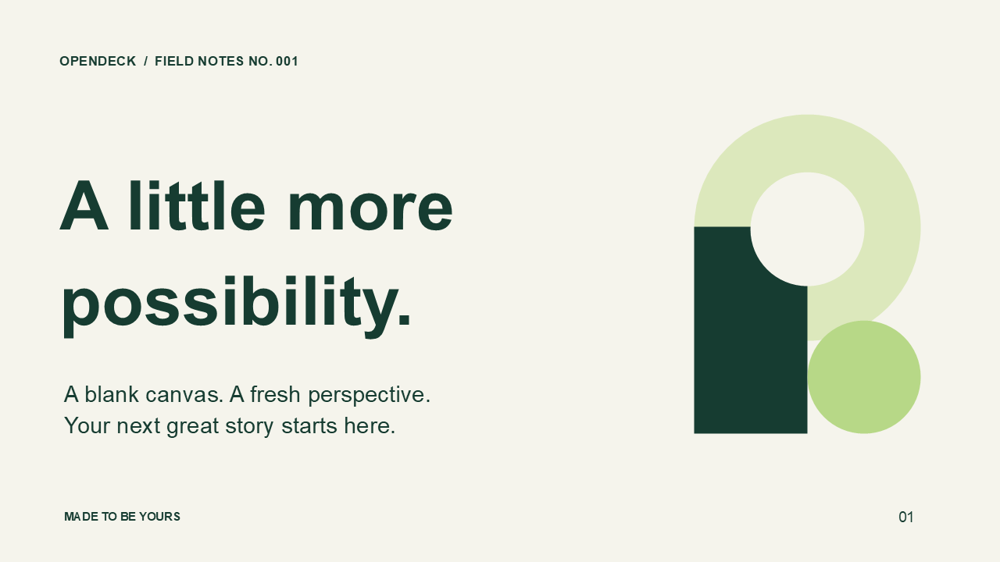
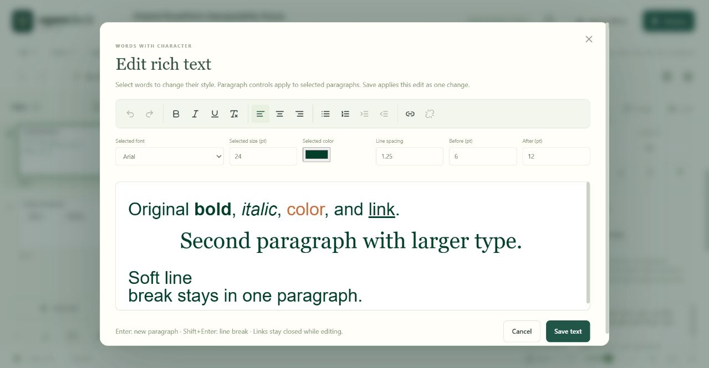
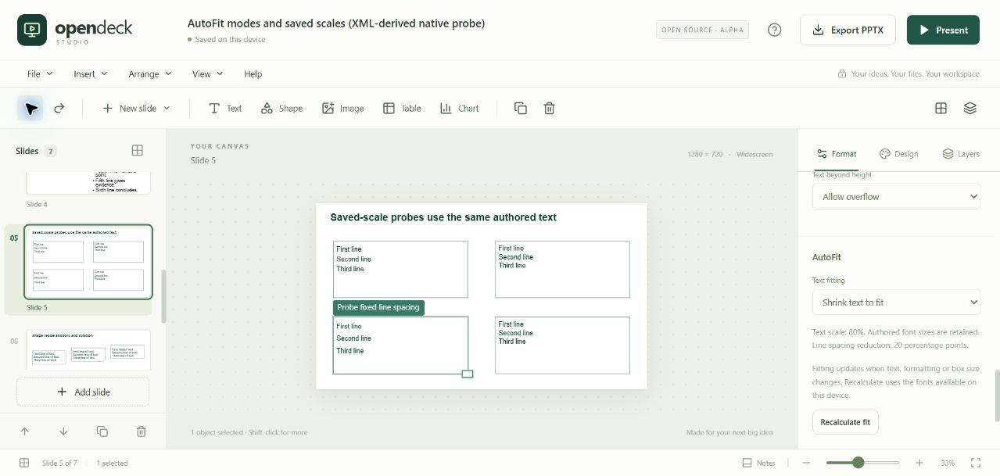
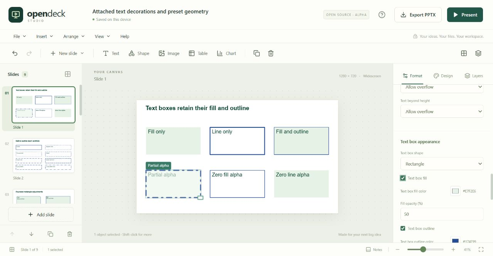
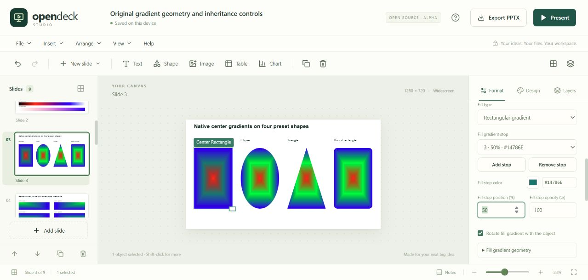

# OpenDeck Studio

An open-source presentation studio for the browser. Create slides, keep your files locally, and exchange editable content through PowerPoint's PPTX format.

**Status: 0.1.0-alpha.6.** OpenDeck is an original implementation with a focused editor, rich text authoring, and partial PPTX compatibility. It is not a complete replacement for every PowerPoint workflow. The [compatibility matrix](docs/COMPATIBILITY.md) states the boundaries; the [roadmap](docs/ROADMAP.md) tracks the work ahead.

[Try the public demo](https://ajayasai.github.io/opendeck-studio/) · [Download the release](https://github.com/ajayasai/opendeck-studio/releases) · [Testing evidence](docs/TESTING.md)



The original [sample deck](examples/field-notes.pptx) above was exported by OpenDeck and rendered by PowerPoint 16.0. Its editable objects, notes, and text also passed a PowerPoint save-and-reimport check. This verifies this sample, not all PowerPoint features.

## Run locally

Use Node.js 22.12 or later and npm.

```sh
git clone https://github.com/ajayasai/opendeck-studio.git
cd opendeck-studio
npm ci
npm run dev
```

Open the localhost address printed by Vite. No account, API key, or backend is required.

```sh
npm test        # automated regression tests
npm run build  # TypeScript check and production bundle
npm run preview
```

## What the alpha focuses on

- A slide canvas with selectable text, shapes, images, tables, and charts.
- A rich text editor for selected-word font, size, color, bold, italic, underline, and safe hyperlinks.
- Structured bullets and numbered lists, nesting and starting numbers, paragraph alignment, line spacing, and spacing before/after.
- Text-box margins, wrapping, independent overflow controls, and top/middle/bottom alignment, with supported layout/master inheritance on PPTX import.
- Shrink-to-fit text and automatic box resizing, preserving authored font sizes and saved PowerPoint fitting factors; relative or exact point-based paragraph line spacing.
- Attached text-box fills and outlines, independent text/paint transparency, eleven outline styles, and editable rectangle, rounded rectangle, ellipse, and triangle text shapes.
- Shape-aware text regions and fitting, plus control over first/last paragraph spacing at the box edges.
- Editable linear, radial, rectangular, and shape gradients for text-box paints, shapes, and slide backgrounds, with individual color stops and transparency.
- Slide organization, five visual themes, reusable layouts, speaker notes, and presentation playback.
- Object alignment, layer ordering, grid snapping, keyboard shortcuts, and a slide sorter.
- Fullscreen presenting with a timer, notes panel, next-slide preview, laser pointer, and blackout control.
- Browser printing and Save as PDF through the browser's print dialog.
- Local editing, undo/redo, browser persistence, a searchable presentation library, and a portable native JSON document.
- Editable PPTX export and a deliberately limited PPTX importer with compatibility warnings.
- A small, understandable TypeScript codebase that contributors can extend and self-host.

Select a text box and choose **Edit styles & lists** to edit selected words and paragraphs. Save applies the result as one undoable change; Cancel keeps the original. Ordinary text edits also retain formatting on unchanged characters. Rich text, lists, and spacing travel through the supported PPTX subset, with explicit warnings for known approximations.



The [rich-text example](examples/rich-text.pptx) and [native OpenDeck copy](examples/rich-text.opendeck) exercise mixed typography, paragraph spacing, links, nested bullets, and numbered lists. Their PowerPoint verification is recorded in the [testing evidence](docs/TESTING.md).

Select a text box and use **Format → Text box** to adjust its four margins, wrap text, or allow/clip overflow on each axis. The [text-frame example](examples/text-frame.pptx) and [native copy](examples/text-frame.opendeck) exercise asymmetric and zero margins, vertical alignment, wrapping, and inherited layout/master properties.

Use **Format → AutoFit** to shrink text or resize its box when text, formatting, or box dimensions change. **Recalculate fit** uses the fonts available in your browser. Imported fitting results stay intact until an edit affects text metrics or you request recalculation. The [autofit example](examples/autofit.pptx) and [native copy](examples/autofit.opendeck) include mixed sizes, saved scaling, fixed line spacing, and rotated resize boxes. The known-scale example is explicitly derived from an XML probe; both it and the original PowerPoint-authored baseline passed a native PowerPoint round trip.



Use **Format → Text box appearance** for solid fills, outlines, preset geometry, and roundness. Text, fill, outline, and whole-object opacity are independent. The [text-decoration example](examples/text-decoration.pptx) and [native copy](examples/text-decoration.opendeck) come from an original nine-slide PowerPoint fixture. Both the original path and a separately XML-derived edge-case probe passed PowerPoint open/render/save/reimport checks. **Include spacing at text box edges** controls first-paragraph spacing before and last-paragraph spacing after.



Use the fill or outline controls in **Format** to choose a gradient, edit its color stops, position, and opacity, or adjust its angle and focus. Slide backgrounds have the same controls in **Format** and **Design**. Theme changes recolor matching gradient stops as one undoable change. The [gradient example](examples/gradients.pptx) and [native copy](examples/gradients.opendeck) exercise native PowerPoint ramps, preset paths, transparency, rotation, and theme inheritance. Both the original nine-slide fixture and an eleven-slide XML-derived probe passed PowerPoint open/render/save/reimport checks. Complex path tiling and transparent color interpolation remain approximations.



Tables and charts use simplified models. Advanced PowerPoint content can change or disappear during import/export; keep the original file and review the result before relying on it. Browser line metrics, autofit recalculation, complete-line clipping, unsupported paints/custom geometry, hyperlink theme colors, and some numbering restarts can differ. See the [compatibility notes](docs/COMPATIBILITY.md).

## Your files

The application runs in your browser and does not require a document-upload service. Browser storage belongs to the browser profile and the exact site origin. Clearing site data, changing the hosting address, or using private browsing can make saved work unavailable. Download native JSON backups for work you want to keep; PPTX is an interchange format, not a lossless OpenDeck backup.

Use **File → My presentations** to reopen saved decks. Autosave keeps separate presentations by document ID, so creating a new deck does not intentionally replace the previous deck's library entry. The library is not version history: opening a native backup with the same document ID updates that presentation when saved.

Earlier plain-text OpenDeck files remain readable. Use alpha.2 or later for rich-text native backups; opening and saving them with alpha.1 can discard the rich formatting.

Use alpha.3 or later for text-frame backups. Earlier readers can discard the optional margins, wrap, and overflow fields when re-saving. Files without these fields retain the earlier zero-margin, wrapped, clipped behavior.

Use alpha.4 or later for autofit and exact line-spacing backups. Earlier readers can discard those optional fields when re-saving. Existing documents retain their saved geometry and font sizes when opened.

Use alpha.5 or later for attached text decorations, text-only opacity, and paragraph-edge policy. Earlier readers can discard those optional fields when re-saving. Legacy native files keep their prior include-edges behavior; imported PPTX files use PowerPoint's default of excluding endpoint spacing unless explicitly enabled.

Use alpha.6 or later for gradient and independent shape/background opacity backups. Earlier readers can discard these optional fields when re-saving. Existing solid paints remain unchanged when no gradient is present.

You can edit without an internet connection after the application and its assets are loaded. For predictable offline access, run the built files on a local static server. This release does not install a PWA or guarantee that a hosted page will reopen offline.

## Self-host

Run `npm run build`, then serve the `dist` directory with any static HTTP server. Asset URLs are relative, so deployment under a repository subpath is supported. Do not rely on opening `dist/index.html` directly with a `file://` URL.

The included GitHub Pages workflow builds and tests `main` before deploying. In a fork, select **Settings → Pages → Build and deployment → GitHub Actions** before the first deployment. CI also runs on pull requests.

## Contribute

Start with [CONTRIBUTING.md](CONTRIBUTING.md), the [architecture](docs/ARCHITECTURE.md), and the [roadmap](docs/ROADMAP.md). Compatibility fixes should include a small, shareable fixture and a clear account of what is preserved or lost. The [testing checklist](docs/TESTING.md) separates automated coverage from browser and presentation-application checks that still require verification.

OpenDeck uses React, TypeScript, Vite, Tiptap/ProseMirror, Lucide, JSZip, and PptxGenJS. Their licenses remain applicable to their respective components. See [third-party notices](public/third-party-notices.txt), [LICENSE](LICENSE) for OpenDeck's MIT license, and [SECURITY.md](SECURITY.md) for reporting security issues.

OpenDeck Studio is independent of Microsoft. PowerPoint is a Microsoft trademark; its name is used here to identify the file format and interoperability target.
